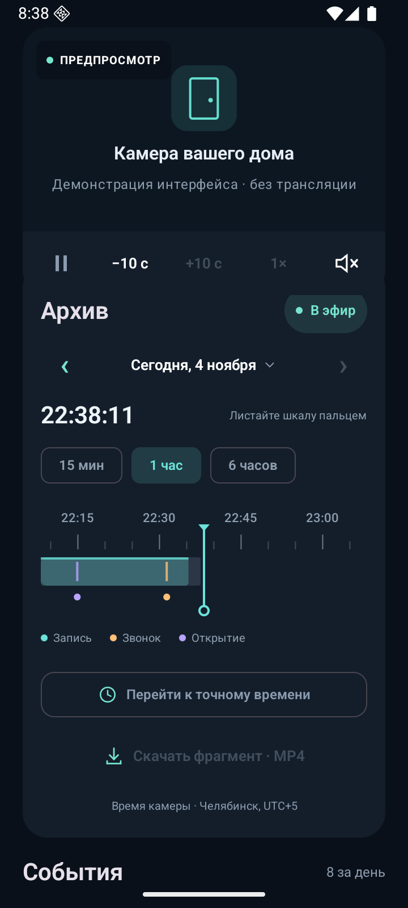
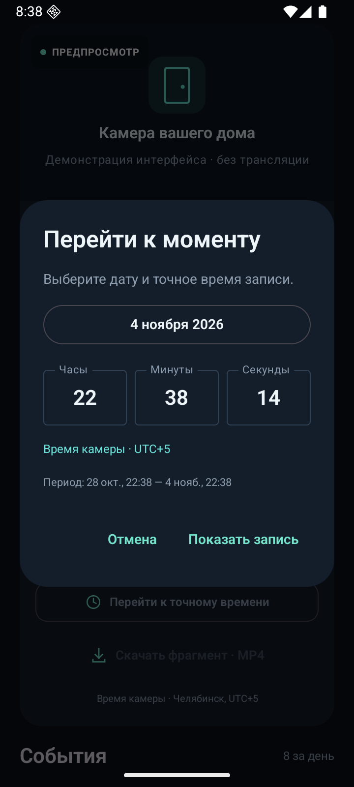
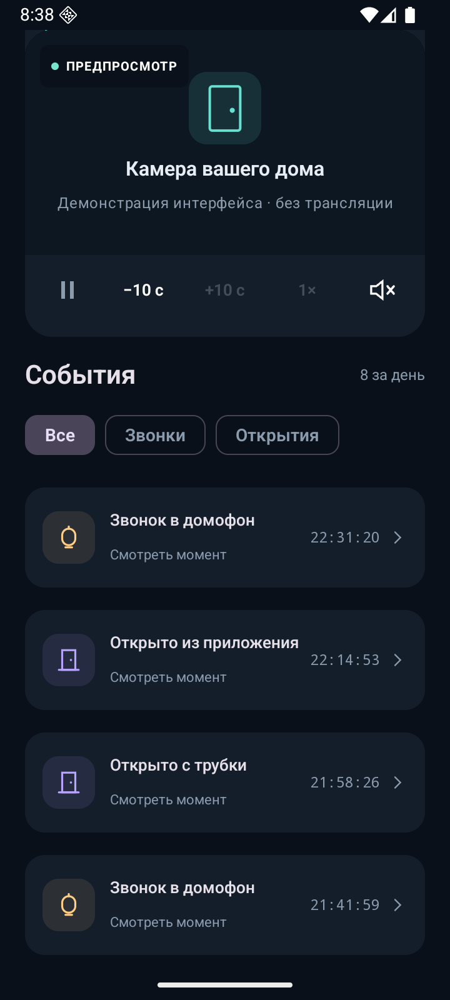

<h1 align="center">Домофон 74</h1>

  Камера, видеоархив и события домофона — в одном Android-приложении. 
  Неофициальный клиент для аккаунтов Интерсвязи.

  
  
  

  <a href="https://github.com/Anateon/domofon74/releases/latest/download/Door74.apk"><strong>⬇ Скачать APK для Android</strong></a>
  &nbsp; · &nbsp;
  <a href="https://github.com/Anateon/domofon74/releases">Все релизы</a>
  &nbsp; · &nbsp;
  <a href="https://github.com/Anateon/domofon74/issues">Сообщить об ошибке</a>

## Что умеет

| Задача | Как это работает |
| --- | --- |
| **Посмотреть, кто у двери** | Прямой эфир, звук, выбор доступного домофона и кнопка открытия с подтверждением. |
| **Найти момент в архиве** | Шкала со временем и наличием записи, масштабы 15 минут / 1 час / 6 часов, шаг ±10 секунд, скорости 1× / 2× / 4×. Календарь и ввод времени до секунды. |
| **Перейти к событию** | Звонки и открытия видны в списке и на шкале. Нажатие открывает запись с запасом до 5 секунд перед событием. |
| **Сохранить видео** | Укажите начало и конец, даже в разные дни. Приложение скачает целые сегменты архива и соберёт **один MP4 без перекодирования**. Есть прогресс, отмена, просмотр и отправка файла. |

Интерфейс на русском, тёмная тема. При прокрутке архива и событий камера остаётся сверху.

## Как выглядит

Все снимки сделаны в **деморежиме**: события вымышлены, трансляция отключена. Реальных адресов и кадров с домофона здесь нет.

<table>
  <tr>
    <th>Архив и шкала времени</th>
    <th>Переход к точному моменту</th>
    <th>История событий</th>
  </tr>
  <tr>
    <td></td>
    <td></td>
    <td></td>
  </tr>
</table>

## Начать пользоваться

1. **[Скачайте Door74.apk](https://github.com/Anateon/domofon74/releases/latest/download/Door74.apk)** на телефон с Android 8.0 или новее.
2. Откройте файл и разрешите установку из выбранного браузера или файлового менеджера, если Android попросит.
3. Введите номер, привязанный к вашему аккаунту Интерсвязи, и следуйте инструкции подтверждения на экране. При нескольких договорах выберите нужный.
4. Выберите домофон. Для просмотра старой записи прокрутите до **«Архив»**, двигайте шкалу или нажмите **«Перейти к точному времени»**.

Сначала можно нажать **«Посмотреть демо»** — без входа, подключения к дому и отправки команд.

Приложение устанавливается отдельно от официального клиента Интерсвязи. Доступные домофоны и глубина архива определяются вашим аккаунтом и сервером.

Если ранее была установлена тестовая версия 0.2.0

У публичного релиза другой ключ подписи. Один раз удалите тестовую версию, установите APK из Releases и войдите заново. Следующие публичные релизы с тем же ключом можно устанавливать поверх, сохраняя данные приложения.

## Скачать фрагмент архива

**«Архив» → «Скачать фрагмент · MP4» → начало и конец → «Сохранить MP4» → папка.**

Загрузка продолжается в фоне. На её карточке можно следить за прогрессом и отменить задачу. Когда файл готов, нажмите **«Открыть»** для просмотра или **«Поделиться»** для отправки через другое приложение.

- Сохраняются целые сегменты HLS: начало файла может быть немного раньше выбранного момента, конец — позже.
- Качество не меняется: видео и звук переносятся в MP4 без перекодирования.
- Разрывы архива объединяются без вставки пустого видео; приложение сообщает об этом в результате.
- Для большого диапазона нужно свободное место под временные сегменты и готовый файл.

## Что важно знать

- Это независимый проект, не официальный продукт Интерсвязи. Работа зависит от доступности и изменений её API.
- В текущей версии время камеры отображается в **UTC+5**. В сетевые запросы передаётся UTC.
- События берутся из истории домофона. Аналитика движения камеры, входящие аудиозвонки/SIP и push-уведомления о звонках не поддерживаются.
- Экспорт рассчитан на доступный незашифрованный HLS-архив MPEG-TS с H.264/H.265 и AAC. При смене параметров кодека внутри периода потребуется сохранить части отдельно.
- На реальном архиве проверены просмотр, переход к событию, скачивание MP4 и воспроизведение с перемоткой. Новый вход по коду и физическое открытие двери при разработке не выполнялись; длительная загрузка на разных моделях телефонов ещё требует проверки. Подробности — в [отчёте о проверках](docs/TESTING.md).

## Конфиденциальность

Сессия хранится на телефоне в зашифрованном виде с Android Keystore и исключена из резервного копирования. При выходе данные сессии удаляются. Запросы идут по HTTPS к сервисам Интерсвязи; приложение не добавляет собственный сервер аналитики.

Аккаунты, токены, перехваченный трафик и реальные видеозаписи не распространяются с исходниками или APK. Подробнее — [обработка данных](docs/PRIVACY.md).

## Для разработчиков

Нативный Android: Kotlin, Jetpack Compose, Media3 и WorkManager. Идентификатор приложения — `ru.is74.door.custom`.

- [Сборка и подпись APK](docs/BUILD.md)
- [Наблюдаемый контракт API](docs/API.md)
- [Результаты и ограничения проверок](docs/TESTING.md)
- [Лицензия MIT](LICENSE)

Нашли проблему? [Создайте issue](https://github.com/Anateon/domofon74/issues) с версией Android, версией приложения и шагами воспроизведения. Перед публикацией удалите из примеров номер телефона, адрес, токены и ссылки на вашу камеру.
